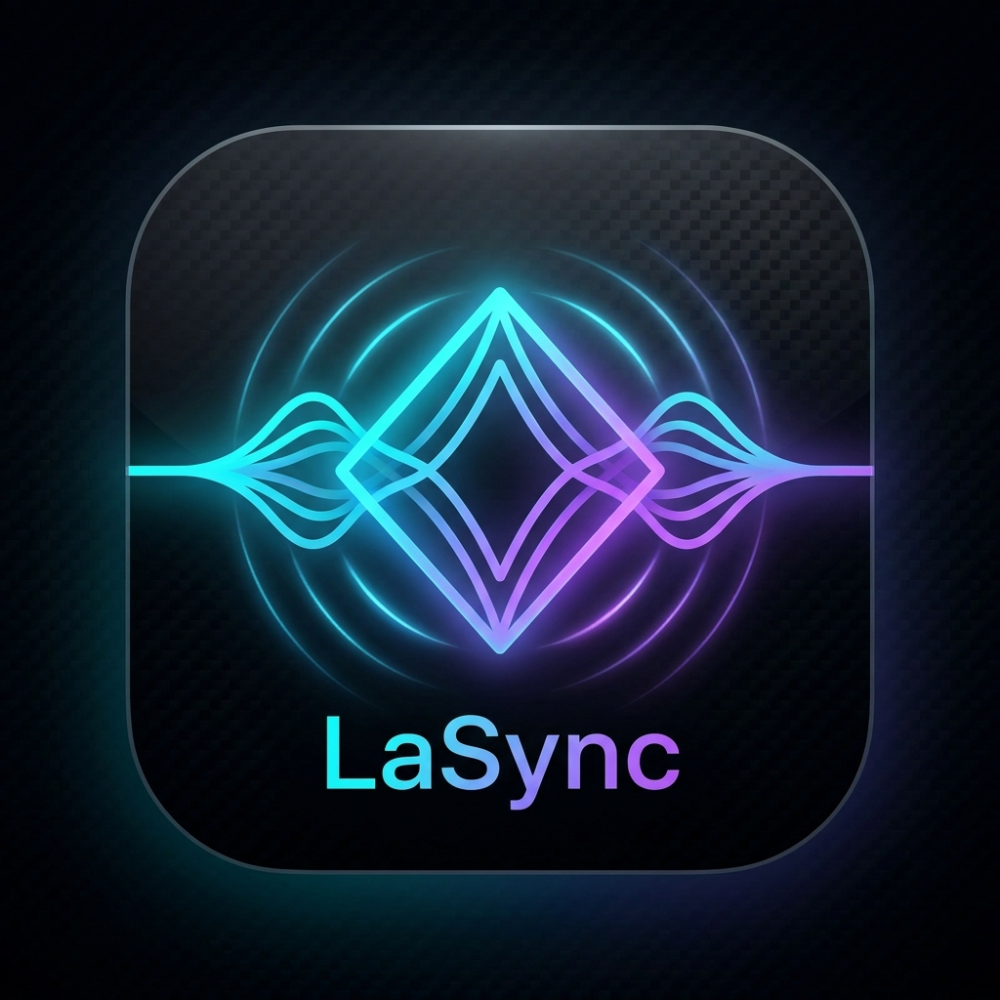

# LaSync 🎵📡

<p align="center">
  
</p>

<p align="center">
  <b>Local Acoustic Synchronizer</b><br/>
  <i>Phase-Locked Multi-Device Audio Timeline Distribution</i>
</p>

<p align="center">
  <a href="https://github.com/SuryakiranMK/LaSync/releases/download/v1.0.5/LaSync.apk">
    
  </a>
  <a href="https://github.com/SuryakiranMK/LaSync/releases/latest">
    
  </a>
</p>

---

## 🏛 Technical Expansion
**LaSync** stands for:
* **L**ocal **A**udio **Sync**hronization Engine
* **L**ow-latency **A**coustic **Sync**hronizer
* **L.A.S.Y.N.C.** $\rightarrow$ **L**ocal **A**coustic **SYN**chronous **C**ast

---

## 🏛 System Architecture

```text
                         HOST PHONE
                    🎵 Master Clock Node
                            │
                     UDP Control (8888)
                     UDP Audio   (8889)
                            │
                    LOCAL WI-FI NETWORK
                            │
             ┌──────────────┼──────────────┐
             ↓              ↓              ↓
          PHONE B         PHONE C        PHONE D
             │              │              │
          Bluetooth      Bluetooth      Bluetooth
             │              │              │
            🎧 B            🎧 C            🎧 D
```

---

## 🎨 Visual Identity & Custom Design System

LaSync features a proprietary **"Cyber-Acoustic Precision"** design language:
- **Palette**: Void Obsidian (`#060811`), Frosted Carbon Glass (`#0D1322`), HyperCyan (`#00F2FE`), Ultraviolet (`#9D4EDD`), and Quantum Mint (`#00F5A0`).
- **Harmonic Wave Equalizer**: A 5-bar live acoustic visualizer that breathes with audio timeline events.
- **Concentric Acoustic Radar**: Multi-ring ripple animations that reflect discovery and link health.
- **Phase-Lock Latency Dial**: Hero gauge showing sub-millisecond hardware clock offsets in real time.

---

## 🚀 Features & Capabilities
 
### Phase 1: High-Precision LAN Time Sync
- **Transport**: Real-time non-blocking UDP socket engine on port `8888`.
- **Discovery**: Automatic Host beacon broadcasting (`255.255.255.255` & subnet) and client discovery.
- **Clock Synchronization**: Sub-millisecond NTP-lite 4-timestamp engine using monotonic `SystemClock.elapsedRealtimeNanos()`.
- **Metrics**: Real-time RTT calculation, RFC 3550 Jitter estimation, packet loss tracking, and sliding-window median spike rejection.
- **Multi-Receiver Scalability**: Host tracks N receivers concurrently with automatic heartbeat pruning.
- **Background Execution**: Android Foreground Service with `WIFI_MODE_FULL_LOW_LATENCY` and `PARTIAL_WAKE_LOCK`.

### Phase 2: Synchronized Audio Streaming & Music Sharing
- **System Music Sharing (Spotify, YouTube, Games)**: Share all live device audio from your phone to connected listeners in real time using Google's `AudioPlaybackCapture` API (excluding phone calls for privacy).
- **Acoustic Benchmark Mode**: 440 Hz concert pitch 'A' sine wave generator for verifying microsecond-accurate acoustic phase alignment.
- **Zero "Rain Noise" Jitter Buffer**: Dedicated 200 ms concurrent memory buffer with blocking full-frame stereo writes, eliminating 16-bit PCM byte-misalignment and buffer underrun crackles.
- **Multi-Client UDP Audio Multicast**: Broadcasts raw 48 kHz 16-bit PCM frames on Port `8889` across the entire local Wi-Fi subnet.

---

## 🛠 Building & Running

### Requirements
- Android SDK (API 35 compileSdk, minSdk 26)
- JDK 21 LTS

### Build APK
```bash
./gradlew assembleDebug
```
Output:
`app/build/outputs/apk/debug/app-debug.apk`

### Run Unit Tests
```bash
./gradlew test
```

### Install via ADB
```bash
adb install -r LaSync.apk
```

---

## 📱 How to Use

1. Connect all phones to the same Wi-Fi network.
2. **Phone 1 (Host)**: Open LaSync → Tap **[ CREATE SESSION ]**.
3. **Phone 2+ (Receivers)**: Open LaSync → Tap **[ JOIN SESSION ]** → Tap **[ JOIN ]** on the discovered host.
4. **To Share Music**: On the Host, tap **[ SHARE SYSTEM MUSIC ]**, approve the permission prompt, open Spotify or YouTube, and play any song!
5. **To Test Tone Sync**: Tap **[ START 440 Hz ACOUSTIC TEST ]** to hear pure, synchronized concert pitch 'A' playing across all devices simultaneously!
